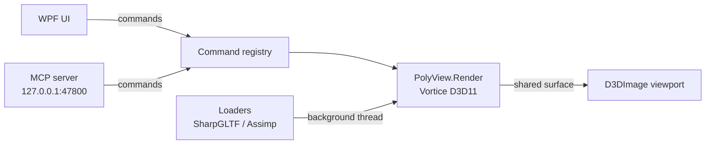

<div align="center">

# PolyView

**A lightweight, fast, Blender-style 3D editor for Windows**

Built with C# / WPF and Direct3D 11, with built-in AI control over MCP

<p>
  
  
  
  
  <br>
  
  
  
  
  
  
</p>

**English** | [简体中文](README.zh-CN.md)

[Overview](#overview) ·
[Features](#features) ·
[Getting Started](#getting-started) ·
[Usage](#usage) ·
[AI Integration (MCP)](#ai-integration-mcp) ·
[Architecture](#architecture) ·
[Roadmap](#roadmap)

</div>

## Overview

PolyView aims to feel like Blender 4.2 in a small, fast, native Windows app: open and inspect 3D models,
build simple scenes from primitives and lights, and export to common formats. It also ships with a
**built-in MCP server that AI assistants connect to automatically**, so tools like Cursor, Claude Code or
Codex can build and edit scenes for you (see [AI Integration](#ai-integration-mcp)).

> [!NOTE]
> PolyView is in **early development**. Formats and features may still change; check the
> [Roadmap](#roadmap) for what is planned.

## Features

| Feature | Description |
| --- | --- |
| **Multi-format import** | glTF / GLB, OBJ, STL, FBX, DAE and more; drag & drop opens a Blender-style import panel and adds the model to the current scene |
| **Export** | FBX, OBJ, glTF, GLB, STL, PLY and DAE |
| **Add objects** | Blender-style **Shift+A** menu with mesh primitives and lights |
| **Blender-style navigation** | Orbit, pan, zoom to cursor, numpad views, orthographic toggle |
| **Shading modes** | Solid, wireframe and lit shading |
| **Outliner & properties** | Scene tree with object / mesh data layers, picking, transform editing |
| **Projects** | `.pvproj` files (scene, thumbnail and assets in one archive), Save / Save As |
| **AI control (MCP)** | Built-in MCP server, zero-config auto-connect for popular AI clients |
| **Modern UI** | Dark Blender-like theme, dark dialogs and title bar, high-DPI ready |
| **Stable memory** | No memory spikes or stutter, even with large models |

### Supported Formats

| Format | Importer | Notes |
| --- | --- | --- |
| .glb / .gltf | SharpGLTF (falls back to Assimp) | Meshes, node transforms, base color texture, vertex colors, double-sided; skinned models in bind pose |
| .obj (+.mtl) | Assimp / custom parser | MTL colors and map_Kd textures |
| .stl | Custom parser | Binary / ASCII; Z-up converted to Y-up |
| .fbx / .dae | Assimp 6.0.2 (Silk.NET.Assimp) | Node transforms, generated normals, diffuse color and textures (incl. embedded FBX textures) |
| .3ds / .ply | Assimp | Not specifically tested |
| three.js JSON | Custom parser | Format 4.x, BufferGeometry + basic primitives, node matrices, base color |
| GLB + KHR_draco_mesh_compression | Google Draco 1.5.7 decoder | .glb only |
| GLB + EXT_texture_webp | SharpGLTF + Windows WIC | Requires the system WebP codec |

Details and measurements: [docs/04 Rendering principles & optimization](docs/04_%E6%B8%B2%E6%9F%93%E5%8E%9F%E7%90%86%E4%B8%8E%E4%BC%98%E5%8C%96.md).

## Getting Started

### Requirements

- Windows 10 / 11
- [.NET 10 SDK](https://dotnet.microsoft.com/download)
- Visual Studio 2026 with the **.NET desktop development** workload
- A GPU supporting Direct3D 11

### Build & Run

```bash
git clone <this-repo-url>
cd PolyView/PolyView
dotnet build PolyView.slnx
dotnet run --project PolyView/PolyView.csproj
```

Or open `PolyView/PolyView.slnx` in Visual Studio and press **F5**.

## Usage

- **Open a model:** File > Open, drag & drop a file onto the window, or run `PolyView.exe <file>`.
- **Navigate:** middle mouse to orbit, Shift + middle mouse to pan, wheel to zoom; numpad keys for front / side / top views and orthographic toggle.
- **Add objects:** press **Shift+A** in the viewport, or use the **Add** menu in the viewport header.
- **Save:** Save overwrites the open `.pvproj`; Save As picks a new file.
- **Export:** File > Export and choose the format.

## AI Integration (MCP)

PolyView includes an [MCP](https://modelcontextprotocol.io/) server, so AI assistants can see and edit
your scene directly. **There is nothing to set up:** open PolyView, open your AI, and ask it to work.

### Zero-config auto-connect

- When PolyView launches it starts a local server at **`http://127.0.0.1:47800/mcp`**
  (Streamable HTTP, localhost only, Origin-checked).
- On every launch it registers itself in the config of the AI clients it finds, merging a `polyview`
  entry without touching your other entries.
- Automatically configured: **Cursor, Claude Code, Claude Desktop** (via `npx mcp-remote`),
  **VS Code, Windsurf, Trae, Gemini CLI** and **Codex CLI**. Restart the AI client once after the first launch.
- Any client can be excluded in **Edit > Preferences > AI / MCP**.
- The **MCP** item in the menu bar shows the server status.

### Clients that need a one-time paste

Some clients (for example **DeepSeek Harness**, **Cherry Studio** and **Doubao**) have no config file
PolyView can write. Copy the config from **Preferences > AI / MCP** and add it once in the client:

```json
{ "mcpServers": { "polyview": { "url": "http://127.0.0.1:47800/mcp" } } }
```

For stdio-only clients use `npx -y mcp-remote http://127.0.0.1:47800/mcp`.

### Tools

Inspired by Blender operators, every feature is registered as a command (such as
`object.add_primitive` or `file.export`), so new features become available to AI automatically.

| Tool | Purpose |
| --- | --- |
| `list_commands` / `describe_command` / `run_command` | Discover and run any registered command |
| `get_scene` | Read the scene tree, objects and transforms |
| `get_viewport_screenshot` | Let the AI see the viewport |
| `add_primitive`, `add_light`, `set_transform`, `import_model` | Shortcuts for the most common actions |

Destructive commands (delete, open file) ask you to confirm in PolyView first.
Design notes: [docs/11 MCP integration design](docs/11_MCP%E6%8E%A5%E5%85%A5%E8%AE%BE%E8%AE%A1.md).

## Architecture

| Area | Choice |
| --- | --- |
| Runtime | .NET 10 (`net10.0-windows`) |
| UI | WPF + [WPF UI](https://github.com/lepoco/wpfui) + [AvalonDock](https://github.com/Dirkster99/AvalonDock) |
| MVVM | [CommunityToolkit.Mvvm](https://github.com/CommunityToolkit/dotnet) |
| Rendering | Direct3D 11 via [Vortice.Windows](https://github.com/amerkoleci/Vortice.Windows), HLSL shaders |
| Viewport hosting | `D3DImage` (WPF controls can overlay the viewport) |
| Model I/O | [SharpGLTF](https://github.com/vpenades/SharpGLTF), Assimp (Silk.NET), custom OBJ / STL parsers |
| AI | ModelContextProtocol.AspNetCore, command registry in `Core/Commands` |



<details>
<summary><b>Why <code>D3DImage</code> instead of <code>HwndHost</code>?</b></summary>

<br>

`HwndHost` embeds a native child window that always draws on top of WPF content, so overlays, popups,
transparency and rounded corners break around the viewport. Rendering into a shared surface shown through
`D3DImage` keeps the viewport a normal WPF element.

</details>

### Memory & Performance Principles

- Vertex / index data is uploaded to the GPU, then the CPU-side copy is released
- Large buffers use `ArrayPool<T>` / `NativeMemory` to avoid Large Object Heap churn
- Zero allocations per frame in the render loop
- All GPU resources are `IDisposable` and released explicitly
- Model loading runs on a background thread; GPU upload happens on the render thread
- MCP commands run on the UI dispatcher and stay fast

### Project Structure

```
PolyView/
├── README.md / README.zh-CN.md
├── PolyView/
│   ├── PolyView.slnx        # Open this in Visual Studio 2026
│   └── PolyView/            # WPF application project
├── Models/                  # Test models (sources in Models/SOURCE.txt)
└── docs/                    # Design docs (numbered, Chinese); index in docs/AGENTS.md
```

## Roadmap

- [ ] Collections and a Blender-style outliner
- [ ] Select all / invert selection, light property editing
- [ ] Recent files and autosave
- [ ] Remaining Shift+A object types
- [ ] Applying all import options
- [ ] Later: measurement, section / exploded views, Blender live link

## Acknowledgements

[WPF UI](https://github.com/lepoco/wpfui) · [AvalonDock](https://github.com/Dirkster99/AvalonDock) ·
[Vortice.Windows](https://github.com/amerkoleci/Vortice.Windows) · [SharpGLTF](https://github.com/vpenades/SharpGLTF) ·
[Assimp](https://github.com/assimp/assimp) · [CommunityToolkit](https://github.com/CommunityToolkit/dotnet) ·
[Model Context Protocol](https://modelcontextprotocol.io/)

Test models come from CC0 sources such as [Kenney](https://kenney.nl/), [Quaternius](https://quaternius.com/)
and [Poly Haven](https://polyhaven.com/).

## License

To be decided (MIT recommended). Third-party libraries keep their own licenses.
