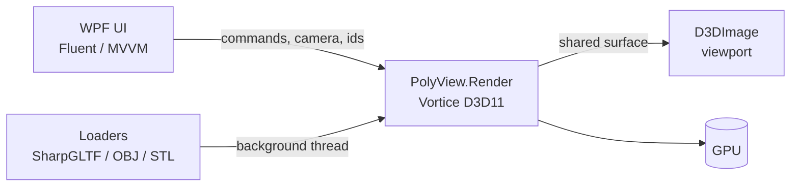

<div align="center">

# 🧊 PolyView

**A lightweight, fast and good-looking 3D model viewer for Windows**

Built with C# / WPF and Direct3D 11

<p>
  
  
  
  
  <br>
  
  
  
  
  
  
</p>

**English** | [简体中文](README.zh-CN.md)

[✨ Features](#-features) •
[🛠️ Tech Stack](#️-tech-stack) •
[🗺️ Roadmap](#️-roadmap) •
[🚀 Getting Started](#-getting-started) •
[📁 Structure](#-project-structure)

</div>

## ✨ 项目亮点 / Highlights

**🤖 内置 MCP：AI 可以直接操控 PolyView / Built-in MCP — AI can drive PolyView directly**

- **零配置 / Zero config**：PolyView 启动时自动开启本机 MCP 服务 `http://127.0.0.1:47800/mcp`（Streamable HTTP，只监听本机）。The MCP server starts with the app, localhost only.
- **扫描 + 一键连接 / Scan & one-click connect**：在「编辑 › 偏好设置 › AI / MCP」中点「扫描」，会列出本机的 AI 客户端（是否已安装、运行中、已连接）。勾选后点「一键连接」，PolyView 会把 `polyview` 条目合并进它们的配置文件，不会动其他条目，第一次修改前会留一份 `.polyview.bak` 备份。目前能自动写入的有 Cursor、Claude Code、Claude Desktop（通过 `npx mcp-remote`）、VS Code、Windsurf、Trae、Gemini CLI、Codex CLI。Cherry Studio 和豆包需要手动粘贴配置。Scan lists installed/running/connected AI clients; connect merges a `polyview` entry safely (other entries kept, one-time `.polyview.bak`).
- **通用配置 / Any MCP client**：一键复制 HTTP 配置或 stdio（`npx mcp-remote`）配置，可以粘贴到任何支持 MCP 的客户端（例如在 Cherry Studio 里接入 DeepSeek 等模型）。Copy-config buttons work for any MCP client.
- **命令系统 / Command registry**：参考 Blender operator，每个功能都注册成一个命令（如 `object.add_primitive`、`file.export`）。AI 通过 `list_commands` / `describe_command` / `run_command` 调用全部命令；`get_scene`、`get_viewport_screenshot`（让 AI 看到视口）以及常用快捷工具 `add_primitive`、`add_light`、`set_transform`、`import_model` 可以直接调用。已注册的命令有：添加基本体/灯光、复制、删除（需要你确认）、变换、显示/隐藏、选择、着色、视图、保存/另存为/打开（需要你确认）、导入、导出 FBX/OBJ/glTF/GLB/STL/PLY/DAE。顶部菜单栏「● MCP」显示服务状态和最近 20 次调用。Every feature is a registered command; AI uses list/describe/run_command. The top bar shows "● MCP" status and recent calls.

```json
{ "mcpServers": { "polyview": { "url": "http://127.0.0.1:47800/mcp" } } }
```

设计文档 / Design: [docs/11_MCP接入设计.md](docs/11_MCP接入设计.md)


---

> [!NOTE]
> PolyView is in **early development (Phase 0)**. Features below are planned unless checked in the roadmap.
>
> **Working today (master):** open OBJ / STL / GLB / glTF (all meshes and primitives, node hierarchy transforms, base color texture & vertex colors; skinned models shown in bind pose), drag & drop a model file anywhere on the window, orbit / pan / zoom.
>
> **On branch `feat/import-xiaoB`:** FBX / DAE / three.js JSON, Draco-compressed GLB and WebP textures, Blender-style navigation (middle mouse, numpad views, ortho), grid floor, on-demand rendering with an FPS readout. See [Supported Formats](#-supported-formats).

## ✨ Features

| | Feature | Description |
| :---: | --- | --- |
| 📂 | **Multi-format import** | OBJ, STL, GLB and glTF (via the Open dialog, drag & drop onto the window, or `PolyView.exe <file>`) |
| 🖱️ | **Smooth navigation** | Orbit, pan and zoom-to-cursor with the mouse |
| 🎨 | **Shading modes** | Solid, wireframe and lit shading |
| 🎯 | **Picking** | Click an object to see its name, vertex / triangle count and bounding box |
| 🌙 | **Modern UI** | Fluent design, dark theme, dockable panels |
| ⚡ | **Stable memory** | No memory spikes or stutter, even with large models |
| 🖥️ | **High-DPI ready** | Crisp viewport at 100% / 150% / 200% scaling |

## 📦 Supported Formats

"Supported (master)" = merged into master; "Supported (feat/import-xiaoB)" = only on 小B's branch, waiting for Ethan to merge; "In progress" = being written; "Planned" = not started. Details and measured numbers: [docs/04_渲染原理与优化.md](docs/04_渲染原理与优化.md).

| Format | Importer | Status | Notes |
| --- | --- | --- | --- |
| .glb / .gltf | SharpGLTF (falls back to Assimp) | Supported (master) | Meshes, node transforms, base color texture, vertex colors, double-sided; skinned models in bind pose |
| .obj (+.mtl) | Custom parser; on the branch Assimp first | Supported (master) | MTL colors and map_Kd textures |
| .stl | Custom parser | Supported (master) | Binary / ASCII; Z-up converted to Y-up on the branch |
| .fbx / .dae | Assimp 6.0.2 (Silk.NET.Assimp) | Supported (feat/import-xiaoB) | Node transforms, generated normals, diffuse color and textures (incl. embedded FBX textures) |
| .3ds / .ply | Assimp | Supported (feat/import-xiaoB), not specifically tested | Same as above |
| three.js JSON (.json, `toJSON()` / editor export) | Custom parser | Supported (feat/import-xiaoB) | Format 4.x, BufferGeometry + Box / Sphere / Cylinder / Plane, node matrices, base color. Most three.js projects ship .glb / .gltf, which already work |
| GLB + KHR_draco_mesh_compression | Google Draco 1.5.7 decoder (Apache-2.0, built from source) | Supported (feat/import-xiaoB), .glb only | Decoded and rewritten before SharpGLTF reads it |
| GLB + EXT_texture_webp | SharpGLTF + Windows WIC | Supported (feat/import-xiaoB) | Shown when the system WebP codec is installed, otherwise skipped safely |

## 🛠️ Tech Stack

| Area | Choice |
| --- | --- |
| Runtime | .NET 10 (`net10.0-windows`) |
| UI | WPF + [WPF UI](https://github.com/lepoco/wpfui) (Fluent) + [AvalonDock](https://github.com/Dirkster99/AvalonDock) |
| MVVM | [CommunityToolkit.Mvvm](https://github.com/CommunityToolkit/dotnet) |
| Rendering | Direct3D 11 via [Vortice.Windows](https://github.com/amerkoleci/Vortice.Windows), HLSL shaders |
| Viewport hosting | `D3DImage` (no airspace issues, WPF controls can overlay the viewport) |
| Model loading | [SharpGLTF](https://github.com/vpenades/SharpGLTF) for glTF / GLB; lightweight custom OBJ / STL parsers |



<details>
<summary><b>💡 Why <code>D3DImage</code> instead of <code>HwndHost</code>?</b></summary>

<br>

`HwndHost` embeds a native child window that always draws on top of WPF content, so overlays, popups,
transparency and rounded corners break around the viewport. Rendering into a shared surface shown through
`D3DImage` keeps the viewport a normal WPF element, which is what makes a polished UI possible.

</details>

## ⚡ Memory & Performance Principles

- ✅ Vertex / index data is uploaded to the GPU, then the CPU-side copy is released immediately
- ✅ Large buffers use `ArrayPool<T>` / `NativeMemory` to avoid Large Object Heap churn
- ✅ **Zero allocations per frame** in the render loop (struct math, no LINQ / closures / string building)
- ✅ All GPU resources are `IDisposable` and released explicitly, never left to the GC
- ✅ Model loading runs on a background thread; GPU upload happens on the render thread
- ✅ Each phase is verified by opening / closing the same model 20 times and checking memory returns to baseline

## 🗺️ Roadmap

- [ ] **Phase 0 – Skeleton:** WPF window + D3D11 viewport, correct resize & DPI handling, clean shutdown
- [ ] **Phase 1 – Test window:** load GLB / glTF, orbit / pan / zoom, solid & wireframe, FPS / triangle / memory overlay
- [ ] **Phase 2 – Main UI:** Fluent theme, scene tree, viewport, property panel, multi-file scenes, picking
- [ ] **Phase 3 – Formats & polish:** OBJ / STL, view cube / axis gizmo, recent folders, loading progress
- [ ] **Later:** measurement, section / exploded views, embedding the viewport in other WPF apps

## 🚀 Getting Started

### Requirements

- 🪟 Windows 10 / 11
- 📦 [.NET 10 SDK](https://dotnet.microsoft.com/download)
- 🧰 Visual Studio 2026 with the **.NET desktop development** workload
- 🎮 A GPU supporting Direct3D 11

### Build & Run

```bash
git clone <this-repo-url>
cd 1023_PolyView/PolyView
dotnet build PolyView.slnx
dotnet run --project PolyView/PolyView.csproj
```

Or open `PolyView/PolyView.slnx` in Visual Studio and press **F5**.

## 📁 Project Structure

```
1023_PolyView/
├── README.md
├── README.zh-CN.md
├── PolyView/
│   ├── PolyView.slnx        # Open this in Visual Studio 2026
│   └── PolyView/            # WPF application project
├── Models/                  # Test models (flat; sources in Models/SOURCE.txt)
└── docs/                    # All docs, numbered; index in docs/AGENTS.md
    ├── AGENTS.md            # Hand-over notes and doc index
    ├── 01_开发计划说明.md     # Development plan (Chinese)
    ├── 02_动作资源网站.md     # Animation resource sites (Chinese)
    ├── 03_3D显示原理与优化.md  # 3D display principles & optimization draft (Chinese)
    └── 04_渲染原理与优化.md    # Rendering pipeline, optimizations, measured capacity (Chinese)
```

## 🧩 Sample Models

Test models come from CC0 (public domain) sources such as [Kenney](https://kenney.nl/),
[Quaternius](https://quaternius.com/) and [Poly Haven](https://polyhaven.com/). Large files are not committed.

## 🙏 Acknowledgements

[WPF UI](https://github.com/lepoco/wpfui) · [AvalonDock](https://github.com/Dirkster99/AvalonDock) ·
[Vortice.Windows](https://github.com/amerkoleci/Vortice.Windows) · [SharpGLTF](https://github.com/vpenades/SharpGLTF) ·
[CommunityToolkit](https://github.com/CommunityToolkit/dotnet)

## 📄 License

To be decided (MIT recommended). Third-party libraries keep their own licenses.

<div align="center">

<sub>Made with ❤️ and C#</sub> · [⬆ Back to top](#-polyview)

</div>
