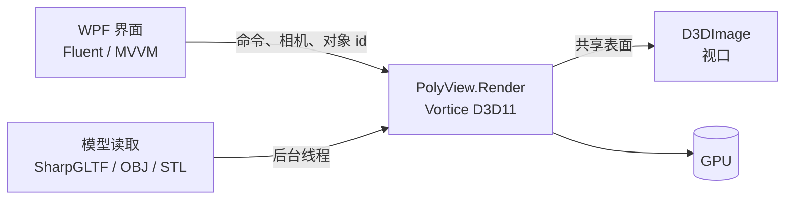

<div align="center">

# 🧊 PolyView

**一个轻量、流畅、颜值在线的 Windows 3D 模型查看器**

基于 C# / WPF 与 Direct3D 11 构建

<p>
  
  
  
  
  <br>
  
  
  
  
  
  
</p>

[English](README.md) | **简体中文**

[✨ 功能](#-功能) •
[🛠️ 技术栈](#️-技术栈) •
[🗺️ 路线图](#️-路线图) •
[🚀 快速开始](#-快速开始) •
[📁 目录结构](#-目录结构)

</div>

---

> [!NOTE]
> PolyView 目前处于**早期开发阶段（第 0 阶段）**。除路线图中已勾选的项目外，下列功能均为计划中。
>
> **目前已经能用（master）：** 打开 OBJ / STL / GLB / glTF（读取全部网格和图元、按节点层级变换，带基础颜色贴图和顶点色；蒙皮模型按绑定姿态显示），把模型文件拖到窗口任意位置即可打开，鼠标旋转 / 平移 / 缩放。
>
> **`feat/import-xiaoB` 分支上：** FBX / DAE / three.js JSON、Draco 压缩的 GLB 和 WebP 贴图、Blender 式导航（中键、小键盘视图、正交）、地面网格、按需渲染和帧率显示。见[支持的格式](#-支持的格式)。

## ✨ 功能

| | 功能 | 说明 |
| :---: | --- | --- |
| 📂 | **多格式导入** | OBJ、STL、GLB、glTF（「打开模型」对话框、直接拖进窗口，或 `PolyView.exe 模型路径`） |
| 🖱️ | **流畅操作** | 鼠标旋转、平移、以光标为中心缩放 |
| 🎨 | **多种显示模式** | 实体、线框、带光照着色 |
| 🎯 | **点选物体** | 点击物体查看名称、顶点数 / 面数、包围盒 |
| 🌙 | **现代界面** | Fluent 设计、深色主题、可停靠面板 |
| ⚡ | **内存稳定** | 打开大模型也不暴涨、不卡顿 |
| 🖥️ | **高分屏适配** | 100% / 150% / 200% 缩放下视口清晰不变形 |

## 📦 支持的格式

「已支持（master）」= 已合并进 master；「已支持（feat/import-xiaoB）」= 只在小B的分支上，等 Ethan 合并；「开发中」= 正在写；「计划中」= 还没开始。详细说明和实测数据见 [docs/04_渲染原理与优化.md](docs/04_渲染原理与优化.md)。

| 格式 | 导入方式 | 状态 | 说明 |
| --- | --- | --- | --- |
| .glb / .gltf | SharpGLTF（失败时退回 Assimp） | 已支持（master） | 多网格、节点变换、基础颜色贴图、顶点色、双面；蒙皮模型按绑定姿态 |
| .obj (+.mtl) | 自带解析器；分支上 Assimp 优先 | 已支持（master） | 读 MTL 颜色和 map_Kd 贴图 |
| .stl | 自带解析器 | 已支持（master） | 二进制 / ASCII；分支上 Z 朝上转成 Y 朝上 |
| .fbx / .dae | Assimp 6.0.2（Silk.NET.Assimp） | 已支持（feat/import-xiaoB） | 节点变换、自动补法线、漫反射颜色和贴图（含 FBX 内嵌贴图） |
| .3ds / .ply | Assimp | 已支持（feat/import-xiaoB），未专门测试 | 同上 |
| three.js JSON（.json，`toJSON()` / 编辑器导出） | 自写解析器 | 已支持（feat/import-xiaoB） | 4.x 格式，BufferGeometry + Box / Sphere / Cylinder / Plane，节点 matrix，基础颜色。多数 three.js 项目发布的是 .glb / .gltf，已经能直接打开 |
| GLB + KHR_draco_mesh_compression | Google Draco 1.5.7 解码库（Apache-2.0，从源码编译） | 已支持（feat/import-xiaoB），只支持 .glb | 解压后重写 GLB 再交给 SharpGLTF |
| GLB + EXT_texture_webp | SharpGLTF + Windows WIC | 已支持（feat/import-xiaoB） | 系统有 WebP 解码器时显示贴图，没有时安全跳过 |

## 🛠️ 技术栈

| 模块 | 选型 |
| --- | --- |
| 运行时 | .NET 10（`net10.0-windows`） |
| 界面 | WPF + [WPF UI](https://github.com/lepoco/wpfui)（Fluent）+ [AvalonDock](https://github.com/Dirkster99/AvalonDock) |
| MVVM | [CommunityToolkit.Mvvm](https://github.com/CommunityToolkit/dotnet) |
| 渲染 | 通过 [Vortice.Windows](https://github.com/amerkoleci/Vortice.Windows) 调用 Direct3D 11，HLSL 着色器 |
| 视口承载 | `D3DImage`（无空气墙问题，WPF 控件可叠加在视口上） |
| 模型读取 | glTF / GLB 使用 [SharpGLTF](https://github.com/vpenades/SharpGLTF)；OBJ / STL 使用轻量自研解析器 |



<details>
<summary><b>💡 为什么用 <code>D3DImage</code> 而不是 <code>HwndHost</code>？</b></summary>

<br>

`HwndHost` 嵌入的是原生子窗口，永远盖在 WPF 内容上面，视口附近的浮层、弹窗、透明和圆角都会出问题。
渲染到共享表面再通过 `D3DImage` 显示，视口就是一个普通 WPF 元素，这才能做出精致的界面。

</details>

## ⚡ 内存与性能原则

- ✅ 顶点 / 索引数据上传到显存后，立即释放内存中的副本
- ✅ 大缓冲区使用 `ArrayPool<T>` / `NativeMemory`，避免大对象堆反复分配
- ✅ 渲染循环**每帧零分配**（结构体数学，不用 LINQ / 闭包 / 字符串拼接）
- ✅ 所有 GPU 资源实现 `IDisposable` 并显式释放，不依赖 GC
- ✅ 模型在后台线程加载，在渲染线程上传 GPU
- ✅ 每个阶段验收：同一模型连续打开 / 关闭 20 次，内存回到基线

## 🗺️ 路线图

- [ ] **第 0 阶段 · 骨架：** WPF 窗口 + D3D11 视口，窗口缩放与 DPI 正确，退出干净
- [ ] **第 1 阶段 · 测试窗口：** 加载 GLB / glTF，旋转 / 平移 / 缩放，实体与线框，帧率 / 面数 / 内存显示
- [ ] **第 2 阶段 · 正式界面：** Fluent 主题、场景树、视口、属性栏，多文件场景，点选
- [ ] **第 3 阶段 · 格式与手感：** OBJ / STL、视图立方 / 坐标轴、最近目录、加载进度
- [ ] **以后：** 测量、剖切 / 爆炸视图、把视口嵌入其他 WPF 程序

## 🚀 快速开始

### 环境要求

- 🪟 Windows 10 / 11
- 📦 [.NET 10 SDK](https://dotnet.microsoft.com/download)
- 🧰 Visual Studio 2026，并安装 **.NET 桌面开发** 工作负载
- 🎮 支持 Direct3D 11 的显卡

### 编译与运行

```bash
git clone <this-repo-url>
cd 1023_PolyView/PolyView
dotnet build PolyView.slnx
dotnet run --project PolyView/PolyView.csproj
```

或在 Visual Studio 中打开 `PolyView/PolyView.slnx`，按 **F5** 运行。

## 📁 目录结构

```
1023_PolyView/
├── README.md                # 英文说明
├── README.zh-CN.md          # 中文说明
├── PolyView/
│   ├── PolyView.slnx        # 用 Visual Studio 2026 打开
│   └── PolyView/            # WPF 主程序项目
├── Models/                  # 测试模型（平铺一层，来源见 Models/SOURCE.txt）
└── docs/                    # 所有文档，按编号排序，索引见 docs/AGENTS.md
    ├── AGENTS.md            # 接手说明与文档索引
    ├── 01_开发计划说明.md
    ├── 02_动作资源网站.md
    ├── 03_3D显示原理与优化.md
    └── 04_渲染原理与优化.md
```

## 🧩 测试模型

测试模型来自 CC0（公共领域）素材，如 [Kenney](https://kenney.nl/)、[Quaternius](https://quaternius.com/)、
[Poly Haven](https://polyhaven.com/)。大文件不提交到仓库。

## 🙏 致谢

[WPF UI](https://github.com/lepoco/wpfui) · [AvalonDock](https://github.com/Dirkster99/AvalonDock) ·
[Vortice.Windows](https://github.com/amerkoleci/Vortice.Windows) · [SharpGLTF](https://github.com/vpenades/SharpGLTF) ·
[CommunityToolkit](https://github.com/CommunityToolkit/dotnet)

## 📄 许可证

待定（推荐 MIT）。第三方库遵循各自的许可证。

<div align="center">

<sub>用 ❤️ 和 C# 打造</sub> · [⬆ 回到顶部](#-polyview)

</div>