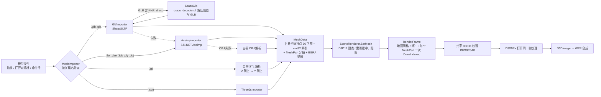

# 04 渲染原理与优化（按实际代码）

> 作者：小B　日期：2026-10-23　分支：`feat/import-xiaoB`
> 本文只写仓库里真实存在的代码和实际测出来的数字。[03_3D显示原理与优化.md](03_3D显示原理与优化.md) 是小U的原理草稿，里面的容量数字是估算；以本文的实测为准。

## 1. 整体流程



- **导入在后台线程**：`ModelViewport.LoadPath` 用 `Task.Run` 调 `MeshImporter.Load`，完成后回到 UI 线程 `ApplyMesh`（上传 GPU、取景）。连续打开多个文件时，用 `_loadVersion` 丢弃过期结果。
- **所有导入器输出同一个 `MeshData`**：节点层级变换在导入时就烘焙进顶点（glTF 走节点矩阵，Assimp 用 `PreTransformVertices`，three.js 走 `object.matrix`），所以渲染时整个模型只有一个 World 矩阵（缩放滑块）。
- **顶点格式**（`Vertex`，36 字节）：位置 float3、法线 float3、UV float2、颜色 RGBA8。索引统一是 32 位（`R32_UInt`）。
- **按需渲染**：挂在 `CompositionTarget.Rendering` 上，但只有 `_dirty` 时才画（相机变化、缩放、改尺寸、前缓冲恢复时 `Invalidate()`）。静止时不画，状态栏显示「空闲」。
- **D3D11 设备**：先试硬件，失败退回 WARP（`SceneRenderer.Create`）。

## 2. 相机与投影

- `OrbitCamera`：目标点 + 偏航 Yaw + 俯仰 Pitch + 距离，Y 轴朝上。Yaw = 0、Pitch = 0 时从 +Z 看向目标（Blender 前视图）。俯仰限制在 ±(90° − 0.001)，避免和世界 Y 轴共线。
- **取景**（`Frame`）：目标 = 包围盒中心，半径 = 包围盒半对角线，距离 = 半径 / sin(FOV/2) × 1.1，默认视角 Yaw 0.6、Pitch 0.35 弧度。FOV 45°。
- **近 / 远平面跟着走**：`near = max(距离 × 0.002, (距离 − 4 × 半径) × 0.5)`，`far = 距离 + 20 × 半径`，半径乘了当前缩放。大模型和小模型的深度精度都够，不会被裁掉。
- **正交**：小键盘 5 切换。正交半高 = 距离 × tan(FOV/2)，和透视下目标平面一样大，切换时画面大小不跳。
- **矩阵约定**：System.Numerics 是行向量（`v * M`），HLSL 用默认列主序 + `mul(M, v)`。C# 端**不转置**直接上传，两者等价。以前同时转置又 `mul(M, v)`，结果投影全错，视口全黑（见 AGENTS.md 的踩坑记录）。
- **宽高比**：用后备缓冲的实际像素（`ActualWidth × DpiScaleX`），不是 WPF 的 DIP 尺寸。
- **导航**（Blender 式）：中键环绕（0.01 弧度 / 像素），Shift + 中键平移，Ctrl + 中键或滚轮缩放（每格 × 0.88），Alt + 左键也能环绕（Alt + Shift + 左键平移，普通左键留给选择 / 变换手柄）；Home / 小键盘 `.` 框选全部（保留当前视角方向）；小键盘 1 / 3 / 7 前 / 右 / 顶，加 Ctrl 看反面。

## 3. 光照与法线

像素着色器（`SceneRenderer.ShaderSource`）：

```hlsl
float key = saturate(dot(normal, LightDirection));            // 主光
float hemisphere = lerp(0.32, 0.55, normal.y * 0.5 + 0.5);    // 天空 / 地面半球环境光
float4 albedo = BaseColorMap.Sample(...) * input.Color;       // 贴图 × 顶点色（材质色已写进顶点色）
color = albedo.rgb * (hemisphere + 0.75 * key);
```

- **主光跟着相机**：方向 = −视线 + 0.45 × 右 + 0.75 × 上，每帧按相机算。从任何角度看，面向你的一面都是亮的。
- **环境光**：0.32（朝下）到 0.55（朝上）。背光面最暗也是基础色的 32%，不会比背景还黑。
- **没有高光、阴影和 PBR**，只用基础颜色（baseColorFactor / 漫反射色 / three.js `material.color`）加基础颜色贴图。
- **双面**：glTF `doubleSided`、Assimp 的 two-sided、three.js `side == 2` 的分段不剔除背面，像素着色器按 `SV_IsFrontFace` 翻转法线。
- **缺法线时自动生成**：
  - STL：用文件里每个三角形的法线；法线为 0 时用叉积算面法线。面积为 0 的退化三角形直接丢掉（所以 grid_1m 是 999,698 而不是 1,000,000 个三角形）。
  - OBJ 自带解析器（Assimp 失败时才用）：有 `vn` 用 `vn`，没有就按面算。
  - Assimp：`GenerateNormals`（平滑组以外的面是平直法线）。
  - glTF / three.js：没有 NORMAL 时按三角形面积加权累加到顶点。
- **负缩放**：节点矩阵行列式 < 0 时交换三角形顶点顺序，否则面会朝里。
- **地面网格**：画在 y = 0 平面，不参与光照（`Unlit`）。格距取 10 的整数次幂，按模型大小选。红线是 X 轴，绿线是 Z 轴（对应 Blender 的 Y 轴）。注意：网格固定在世界原点，不是贴在模型底部；模型本身跨过 y = 0 时，网格线会穿过模型（和 Blender 一样）。

## 4. 优化：已做 vs 待做

| 项目 | 状态 | 说明（对应代码） |
| --- | --- | --- |
| 按需渲染 | 已做 | `_dirty` 才画，静止时 GPU 几乎不用 |
| 渲染循环零分配 | 已做 | 常量缓冲用指针直接写（`WriteConstants`，unsafe），不用 `Marshal.StructureToPtr`；槽位数组都是预分配的字段 |
| 后台线程导入 | 已做 | `Task.Run`，大文件导入时界面不卡 |
| 一次性上传 GPU | 已做 | 顶点 / 索引各一个缓冲，贴图 `Immutable` |
| 每个材质分段一次 DrawIndexed | 已做 | 分段数 = 材质数（three.js 是每个 Mesh 一段） |
| 贴图 mipmap | 待做 | 现在 `MipLevels = 1`，缩小看时贴图会闪 |
| 抗锯齿（MSAA） | 待做 | 现在 `SampleDescription(1, 0)` |
| 视锥剔除 / LOD | 待做 | 现在整个模型一次全画；单个模型的查看器暂时够用 |
| 顶点压缩 | 待做 | 法线 / UV 可以压成 16 位，36 字节 → 约 20 字节，显存和带宽能省一半左右（未实测） |
| 导入时的峰值内存 | 待做 | 导入先放进 `List<Vertex>`，再 `ToArray()`，上传后 CPU 端的 `MeshData` 还留着（拾取要用）。5M 三角形时私有内存约 1.9 GB，见下表 |
| 释放 | 已做 | 换模型时释放旧缓冲和贴图；控件卸载时 Dispose 全部 D3D11 / D3D9 对象 |

## 5. 实测容量

### 测试环境

| 项目 | 值（由系统报告） |
| --- | --- |
| 显卡（DXGI 适配器） | Intel(R) Iris(R) Xe Graphics，驱动 32.0.101.6790，AdapterRAM 报告 2147479552 字节（核显，共享内存） |
| 其他显示设备 | OrayIddDriver Device（向日葵远程桌面的虚拟显示器） |
| CPU | 系统报告为 Intel(R) Core(TM) i5-14400F（14400F 不带核显，和 Iris Xe 同时出现不太对，这里照原样记录） |
| 内存 | 15.9 GB |
| 显示器 | 2560 × 1440 @ 60 Hz |
| 视口 | 1084 × 609 像素（默认窗口大小） |
| 程序 | Debug 版，`net10.0-windows`，AnyCPU（在 64 位 Windows 上是 64 位进程） |

### 方法

`PolyView.exe --bench <模型> <输出.tsv>`（`MainWindow.xaml.cs` + `ModelViewport.StartBenchmark`）：

1. 正常加载模型，记录导入耗时（后台线程里 `MeshImporter.Load` 的时间）和上传耗时（`SetMesh`）。
2. 预热 1 秒，然后 3 秒内每帧转一点相机，统计 vsync 下的 FPS。
3. 再画 60 帧，每帧后用 D3D11 Event 查询等 GPU 做完（`WaitForGpu`），得到 GPU 每帧毫秒数，以及「不受 vsync 限制时理论上最多多少帧」（1000 / 毫秒）。
4. 记录进程工作集和私有内存，写一行 TSV，退出。

合成测试模型由脚本生成在 `%TEMP%\pv\bench\`（不提交）：起伏的方格网，STL 是二进制、每个三角形 3 个独立顶点；OBJ 是 `v` + `f`、没有法线。

### 合成模型

| 文件 | 大小 | 顶点 | 三角形 | 导入 ms | 上传 ms | vsync FPS | GPU ms/帧 | 理论帧率上限 | 工作集 MB | 私有内存 MB |
| --- | ---: | ---: | ---: | ---: | ---: | ---: | ---: | ---: | ---: | ---: |
| grid_100k.stl | 4.8 MB | 301,056 | 100,352 | 146 | 10 | 61.6 | 1.00 | 1005 | 202 | 195 |
| grid_500k.stl | 23.8 MB | 1,500,000 | 500,000 | 633 | 36 | 62.2 | 2.59 | 385 | 294 | 384 |
| grid_1m.stl | 47.7 MB | 2,999,094 | 999,698 | 861 | 102 | 62.3 | 4.15 | 241 | 408 | 615 |
| grid_1m.obj | 34.3 MB | 2,944,783 | 999,698 | 2558 | 75 | 62.6 | 5.06 | 198 | 553 | 804 |
| grid_5m.stl | 238 MB | 14,997,366 | 4,999,122 | 2404 | 607 | **48.0** | 18.58 | 54 | 810 | 1940 |

读法：

- 100 万三角形以内，这台机器 GPU 每帧 1 到 5 ms，FPS 被显示器的 60 Hz 卡住，很流畅。
- 500 万三角形时 GPU 每帧 18.6 ms，已经掉到 60 帧以下（实测 48 FPS），还能转，但能感觉到。
- OBJ 比 STL 慢：要解析文本，而且走 Assimp。OBJ 文件里的顶点是共享的，但它没有法线，Assimp 会生成平直法线，把顶点又拆开了，所以顶点数和 STL 差不多（约为三角形数的 3 倍）。

### Models 里的模型和图库模型

| 文件 | 顶点 | 三角形 | 导入 ms | 上传 ms | vsync FPS | GPU ms/帧 | 工作集 MB | 私有内存 MB |
| --- | ---: | ---: | ---: | ---: | ---: | ---: | ---: | ---: |
| barrel.obj | 96 | 56 | 59 | 2 | 62.2 | 0.47 | 183 | 155 |
| barrel.stl | 168 | 56 | 4 | 2 | 62.2 | 0.49 | 178 | 147 |
| barrel.fbx | 96 | 56 | 55 | 2 | 62.2 | 0.67 | 182 | 147 |
| barrel.dae | 96 | 56 | 51 | 2 | 62.2 | 0.48 | 182 | 148 |
| barrel.glb | 96 | 56 | 129 | 2 | 62.3 | 0.54 | 185 | 148 |
| watertower.obj | 229 | 146 | 102 | 4 | 62.2 | 0.42 | 191 | 165 |
| watertower.fbx | 231 | 146 | 103 | 3 | 62.2 | 0.47 | 189 | 158 |
| watertower.gltf | 231 | 146 | 133 | 4 | 62.2 | 0.45 | 188 | 158 |
| Knight.fbx | 5,328 | 5,800 | 112 | 3 | 62.2 | 0.52 | 191 | 160 |
| Knight.glb | 5,328 | 5,800 | 282 | 3 | 61.9 | 0.55 | 200 | 169 |
| threejs_scene.json | 733 | 1,068 | 17 | 2 | 62.3 | 0.42 | 180 | 155 |
| EmberBlade.glb（Draco + WebP） | 37,894 | 49,952 | 729 | 7 | 61.6 | 0.60 | 239 | 218 |
| JiangShi_raw.glb（Draco + WebP） | 33,036 | 50,000 | 495 | 7 | 62.3 | 0.59 | 219 | 199 |
| StoneLantern_raw.glb（Draco + WebP） | 30,740 | 50,024 | 497 | 6 | 62.2 | 0.56 | 255 | 235 |
| Kael.glb（只有 WebP，无 Draco） | 34,473 | 49,986 | 775 | 21 | 62.2 | 0.58 | 282 | 315 |

每个模型都是单独启动一次程序测的，所以导入时间里包含 SharpGLTF / Assimp / Draco 第一次加载的开销（同一个进程里第二次打开会更快）。空程序本身大约占 150 MB 私有内存（WPF + D3D11 + D3D9Ex）。

### 上限在哪里

- **32 位索引**：索引是 `uint`，单个模型最多约 42.9 亿个顶点，实际碰不到，先碰到的是内存。
- **CPU 内存**：每个顶点 36 字节、每个三角形 12 字节索引。STL 每个三角形 3 个独立顶点，相当于每个三角形约 120 字节。导入时 `List` 扩容和 `ToArray()` 会让峰值翻倍，`MeshData` 上传后还留在内存里。实测 5M 三角形私有内存 1.9 GB；按这个比例，15.9 GB 的机器大概 20M 到 30M 三角形会吃紧（**推算，未实测**）。
- **显存**：5M 三角形的 STL 是 15M 顶点 × 36 B ≈ 540 MB 顶点缓冲 + 60 MB 索引缓冲。Iris Xe 是核显，用的是共享系统内存。D3D11 对单个缓冲有大小上限（与显存有关，规范保证至少 128 MB），独显显存小的机器上，更大的模型可能 `CreateBuffer` 失败。现在没有拆分缓冲，失败时状态栏会显示错误（未实测到这一步）。
- **GPU**：这块 Iris Xe 每 100 万三角形大约 4 ms（只算顶点 + 简单光照）。要保持 60 FPS，单个模型大约在 300 万到 400 万三角形以内（按上表推算）。
- **vsync**：`CompositionTarget.Rendering` 跟着显示器刷新（这里 60 Hz），所以 `--bench` 测到的 FPS 最高约 60；看 GPU 余量要看上表的「GPU ms/帧」。

## 6. 支持的格式

「已支持（master）」表示已经在 master 上；「已支持（feat/import-xiaoB）」表示只在小B的分支上，等 Ethan 合并；「开发中」表示还在写；「计划中」表示还没开始。

| 格式 | 导入方式 | 状态 | 说明 |
| --- | --- | --- | --- |
| .glb / .gltf | SharpGLTF 1.0.7（失败时退回 Assimp） | 已支持（master） | 多网格、多图元、节点变换、基础颜色贴图、顶点色、双面；蒙皮模型按绑定姿态显示 |
| .obj (+.mtl) | master：自带解析器；分支：Assimp 优先，失败退回自带 | 已支持（master）；读 MTL 贴图：已支持（feat/import-xiaoB） | 读 MTL 颜色和 map_Kd 贴图 |
| .stl | 自带解析器 | 已支持（master） | 二进制 / ASCII；Z 朝上转 Y 朝上：已支持（feat/import-xiaoB）；STL 没有颜色，显示为白色 |
| .fbx / .dae | Assimp 6.0.2（Silk.NET.Assimp 2.23.0） | 已支持（feat/import-xiaoB） | 节点变换烘焙进顶点，缺法线自动生成，读漫反射颜色和贴图（含 FBX 内嵌贴图） |
| .3ds / .ply | Assimp | 已支持（feat/import-xiaoB），未专门测试 | 同上 |
| three.js JSON（.json，`toJSON()` / 编辑器导出） | 自写解析器 `ThreeJsImporter.cs` | 已支持（feat/import-xiaoB） | 见下文 |
| GLB + KHR_draco_mesh_compression | 自编译的 Google Draco 1.5.7 解码库 + `DracoGlb.cs` | 已支持（feat/import-xiaoB），只支持 .glb | 见下文；.gltf + Draco 会提示请用 .glb |
| GLB + EXT_texture_webp | SharpGLTF 读扩展 + Windows WIC 解码 | 已支持（feat/import-xiaoB） | 系统装有 WebP 的 WIC 解码器（Windows 10 / 11 一般自带「WebP 图像扩展」）时显示贴图；没有时安全跳过贴图，只显示基础颜色 |

### three.js JSON

- 识别 `metadata.version` 4.x 的 Object / Scene 格式（`Object3D.toJSON()`、three.js 编辑器「导出场景 / 导出对象」）。没有 `metadata`、旧的 `formatVersion 3` 或者不是 three.js 的 .json，会在状态栏给一行提示，不会崩溃。
- 几何体：`BufferGeometry` 的 `position` / `normal` / `uv` / `color` 和 `index`（支持 normalized 整数属性）；没有法线时自动算。另外支持参数化的 `BoxGeometry` / `SphereGeometry` / `CylinderGeometry` / `PlaneGeometry`（含旧名 `BoxBufferGeometry` 等），生成方式和 three.js 一致。其他类型（Torus、Extrude 等）以及 Line / Points 跳过，状态栏写「已跳过不支持的几何体：…」。
- 变换：每个节点的 `matrix`（16 个数，列主序）按对象树累乘（`世界 = 本地 × 父世界`），对应 `System.Numerics` 的行向量约定，按顺序填进 `Matrix4x4` 就行。不可见（`visible: false`）的节点跳过。
- 材质：只取 `color`（转成 sRGB 显示）和 `side`（2 = 双面），不读贴图。
- 测试文件 `Models/threejs_scene.json`：用 three r186 真实导出（红色立方体、蓝色球、旋转 + 缩放过的父子组里的绿色圆柱，导出前转成 BufferGeometry）。PolyView 读出 733 顶点 / 1068 三角形 / 3 段，包围盒和 three.js `Box3.setFromObject` 的结果一致。
- **说明：多数 three.js 项目发布的是 .glb / .gltf**（three.js 官方推荐的格式），这些 PolyView 早就能直接打开；.json 主要来自 three.js 编辑器或 `toJSON()`。

### Draco（KHR_draco_mesh_compression）

- Ethan 的模型图库（https://20261022-model-gallery.pages.dev/ ）54 个 GLB 里有 52 个用了 Draco 压缩 + `EXT_texture_webp`（部分还有 `KHR_materials_specular`）。SharpGLTF 不支持 Draco，所以不处理就打不开。
- 做法（`DracoGlb.cs`）：
  1. 读 GLB 的 JSON，找出带 `KHR_draco_mesh_compression` 的图元。
  2. 对每个图元，把它指向的 bufferView 交给原生 `draco_decoder.dll` 解码。
  3. 把解出的索引（uint32）和各属性（按 Draco 的 unique id 对应 glTF 属性）追加到 BIN 块，改写对应的 accessor，并重新计算 min / max（量化后的数值会超出原来的 min / max，SharpGLTF 会校验）。
  4. 从图元和 `extensionsUsed` / `extensionsRequired` 里删掉这个扩展。
  5. 生成新的 GLB 字节，交给 SharpGLTF 正常读取。
- 解码库：Google Draco 1.5.7（commit 8786740），**Apache-2.0**，用它自带的 C 接口（`DRACO_UNITY_PLUGIN`），在 Linux 上用 mingw-w64 交叉编译成静态链接的 64 位 DLL，只依赖 KERNEL32 和 msvcrt。来源、编译命令和 SHA-256 见 `PolyView/PolyView/native/win-x64/README.txt`，许可证原文在同目录 `draco_LICENSE.txt`。
- 找不到 `draco_decoder.dll` 时，状态栏提示「该 GLB 使用 Draco 压缩，但找不到 Draco 解码库 draco_decoder.dll，暂不支持。」
- 实测（三角形数和图库清单一致）：Bonewarden、EmberBlade、JiangShi_raw、OldTree_raw、PottedPlant_raw、Qingxu、StoneLantern_raw 都能正常解码；在 Ethan 的电脑上，EmberBlade、JiangShi_raw、StoneLantern_raw（Draco + WebP）和 Kael（只有 WebP）都通过了上面的性能测试。截图检查了 EmberBlade、StoneLantern_raw 和 Kael，模型和 WebP 贴图都正常显示。

## 6.5 场景层级、相机、灯光（导入器输出 API）

规格见 [07_灯光规格.md](07_灯光规格.md)（novel，3c02b9c）。导入器在合并好的世界坐标网格之外，额外输出：

- `MeshData.Nodes : SceneNode[]`：深度优先，父在子前，`Nodes[i].Index == i`。字段 `Index`、`Name`、`Parent`（-1 为根）、`Kind`（Empty / Mesh / Camera / Light）、`Local`、`World`（System.Numerics 行向量约定）、`PartIndices`（本节点自己的 Parts 下标）、`Children`、`Camera?`、`Light?`。顶点已经烘焙到世界坐标，`World` 不要再乘。STL / 自带 OBJ 解析器只有一个根 Mesh 节点（Parts 为空时它拥有整份索引）。
- `SceneCamera`：`Orthographic`、`YFov`（弧度）、`OrthoHalfHeight`、`AspectRatio`、`Near`、`Far`。
- `SceneLight`：`Type`（`SceneLightType { Unknown, Directional(=Sun), Point, Spot, Ambient, Area }`）、`Color`（线性 RGB）、`Intensity`（文件原值）、`Power`（Blender 单位：Point / Spot / Area 为 W，Sun 为 W/m²）、`Radius`、`Range`（0 = 无限）、`InnerConeAngle` / `OuterConeAngle`（半角）、`SpotSize`（= 2 × outer）、`SpotBlend`、`Shape`（`AreaShape { Square, Rectangle, Disk, Ellipse }`）、`Size`（Vector2）。
- `MeshData.World : SceneWorld { Color, Strength, FromFile }`：环境光，不是节点；文件里没有时为默认值。

单位换算（与 Blender glTF 导入器 Standard 模式源码一致，`PBR_WATTS_TO_LUMENS = 683`）：

| 来源 | 换算 |
| --- | --- |
| glTF point / spot（cd） | W = cd × 4π / 683 |
| glTF directional（lux） | W/m² = lux / 683（07 里写的「不除 683」与 Blender 实际导入源码不符，按源码） |
| glTF spot 锥角 | Spot Size = 2 × outer；Blend = 1 − inner / outer |
| glTF 面光 / World | 节点 `extras.polyview_light = {"type":"area","shape":"rectangle","size":[2,1],"power":100,"color":[r,g,b]}`（点光 / 聚光可给 `radius`）；场景 `extras.polyview_world = {"color":[r,g,b],"strength":1}` |
| Assimp | 颜色拆成归一化颜色 + 最大分量；Power = 分量 × 1000（经验值，Notice 提示「强度已估算」）；Sun 直接用分量；锥角按半角；Ambient 颜色相加并入 World；Undefined 跳过并写 Notice |
| three.js | 点光 / 聚光 cd、平行光 lux 同 glTF；RectAreaLight nit × 面积 × π / 683；Ambient / Hemisphere 并入 World |

测试模型 `Models/camera_light_test.glb`（自己用 SharpGLTF 生成，CC0）：Cube、Rig（空）→ Camera（透视 yfov 0.8）、Sun 3 W/m²、PointLight 1000 W（radius 0.25，range 10）、SpotLight 1000 W（Spot Size 68.8°，Blend 0.15）、AreaLight 矩形 2 × 1 m 500 W、World (0.05, 0.06, 0.08) × 1。
## 7. 相关文件

`ModelViewport.cs`（视口、导航、性能测试）、`SceneRenderer.cs`（D3D11、着色器、网格）、`OrbitCamera.cs`、`MeshImporter.cs`、`GltfImporter.cs`、`DracoGlb.cs`、`AssimpImporter.cs`、`ThreeJsImporter.cs`、`TextureDecoder.cs`、`MeshData.cs`。
`ModelViewport.cs`（视口、导航、FPS、性能测试）、`SceneRenderer.cs`（D3D11、着色器、网格）、`OrbitCamera.cs`、`MeshImporter.cs`、`GltfImporter.cs`、`DracoGlb.cs`、`AssimpImporter.cs`、`ThreeJsImporter.cs`、`TextureDecoder.cs`、`MeshData.cs`。

## 第 2 阶段：多对象场景、拾取、选中高亮（小U / program，2026-10-23）

### 数据结构

- `Core/SceneObject.cs`：一个打开的文件 = 一个 `SceneObject`（`Id`、`Name`、`SourcePath`、`MeshData`）。`Id` 从 1 递增、本次运行内不复用；-1 表示「没有对象 / 未选中」。
- `SceneRenderer` 不再只有一组缓冲，改为 `List<GpuObject>`，每个对象各自持有顶点 / 索引缓冲和贴图，`AddMesh(id, mesh)` / `RemoveMesh(id)` / `ClearMeshes()` 时创建或 Dispose；`Dispose()` 会释放全部对象。
- 地面网格按**整个场景**的包围盒重建（`UpdateGrid`），「框选全部 / 复位视角」也按场景包围盒。
- 导入器目前把整个文件合并成一个 `MeshData`（顶点已烘焙到世界坐标，没有节点层级），所以场景树暂时只能「一个文件一行」。要显示 glTF 节点层级，需要导入器（小B 负责）额外输出节点树：每个节点的名称、父节点、对应的 `MeshPart` 区间或子网格。

### 渲染流程变化

每帧：清屏 → 画地面网格（unlit 线段）→ `for` 遍历对象：写一次常量缓冲（WorldViewProj、NormalWorld、光照方向、`Highlight`）→ 绑定该对象的顶点 / 索引缓冲 → 按 `MeshPart` 逐段 `DrawIndexed`。

- 常量缓冲新增 `float Highlight` + `float3 Padding`（保持 16 字节对齐，共 160 字节）。选中对象在像素着色器里往橙色 `(1.0, 0.62, 0.18)` 混 45%，贴图模型和线框模式下都看得出来。
- 矩阵约定不变：C# 端 `world * view * projection` **不转置**上传，HLSL 用 `mul(M, v)`。
- 渲染循环零托管分配：`for` 循环 + 预分配的槽数组，常量缓冲用指针直接写（不走 `Marshal.StructureToPtr` 装箱）。
- 线框：`Wireframe` 属性 / 快捷键 Shift+Z，切换光栅化状态（单面 / 双面各有实心和线框两套，启动时建好）。

### 拾取

`Core/Picking.cs`：

1. `CreateRay`：鼠标位置（DIP，相对视口）→ NDC → 乘 `(view * projection)` 的逆矩阵，得到近 / 远平面两点，组成世界空间射线。view / projection 和渲染**共用** `SceneRenderer.GetViewProjection`（含正交模式），保证点到哪选到哪。用 DIP 宽高即可，比例和像素后备缓冲一致，150% DPI 下不偏。
2. 射线按世界变换的逆矩阵变回模型空间（方向不归一化，t 在各对象之间可直接比较）。
3. 先 AABB slab 粗筛（进入距离比当前最近命中还远的对象直接跳过），再逐三角形 Möller–Trumbore（双面），取最近命中，返回 `PickHit(ObjectId, Distance, TriangleIndex)`。
4. 视口：普通左键按下记录位置，松开时移动 < 4 DIP 视为单击 → `Select(PickAt(p))`；没打中返回 -1，即点空白处取消选择。Esc 也取消选择。环绕仍是中键 / Alt+左键，不冲突。

### 实测（Intel Iris Xe，Windows，视口约 1084×609 像素）

用 `PolyView.exe --bench`（本分支 Debug 构建）逐个打开 Models 里的模型，每个模型单独起一个进程，所以「加载」是冷启动耗时（含 JIT）：

| 模型 | 顶点 | 三角形 | 加载 ms（冷） | 上传 ms | 刷新同步 FPS | GPU 每帧 ms | 工作集 MB |
| --- | ---: | ---: | ---: | ---: | ---: | ---: | ---: |
| barrel.dae | 96 | 56 | 517 | 2 | 68.6 | 0.55 | 186 |
| barrel.fbx | 96 | 56 | 58 | 2 | 62.3 | 0.83 | 182 |
| barrel.glb | 96 | 56 | 294 | 2 | 65.0 | 0.67 | 187 |
| barrel.obj | 96 | 56 | 65 | 2 | 61.6 | 0.50 | 177 |
| barrel.stl | 168 | 56 | 4 | 2 | 62.3 | 0.56 | 175 |
| Knight.fbx | 5328 | 5800 | 117 | 3 | 61.6 | 0.53 | 188 |
| Knight.glb | 5328 | 5800 | 303 | 3 | 62.3 | 0.58 | 197 |
| watertower.fbx | 231 | 146 | 110 | 4 | 62.2 | 0.43 | 185 |
| watertower.gltf | 231 | 146 | 159 | 3 | 62.3 | 0.49 | 188 |
| watertower.obj | 229 | 146 | 117 | 3 | 62.3 | 0.45 | 188 |

拾取耗时（Release 小程序，预热后对模型中心打一条射线，20 次取平均）：

| 模型 | 三角形 | 热加载 ms | 单次拾取 ms |
| --- | ---: | ---: | ---: |
| barrel.*（5 种格式） | 56 | 0.2–7.5 | 0.04 |
| watertower.*（3 种格式） | 146 | 6.6–17.9 | 0.10 |
| threejs_scene.json | 1068 | 5.0 | 0.66 |
| Knight.fbx | 5800 | 27.6 | 1.03 |
| Knight.glb | 5800 | 133.6 | 0.74 |

结论：现有模型都很小，渲染被显示器刷新率（约 60 Hz）卡住，GPU 每帧不到 1 ms；拾取只在单击时做一次，逐三角形暴力测试在万级三角形内足够快。

### 待做（数字为**估算**）

- 拾取加速：按上表约 0.15 µs / 三角形线性外推，50 万三角形约 75 ms（估算），届时给每个对象建 BVH。
- 每对象世界变换：现在所有对象共用一个世界矩阵，移动 / 旋转 / 缩放单个对象需要 `SceneObject` 带 `Transform`；拾取已按「射线变回模型空间」写好，届时换成每对象的逆矩阵即可。
- 场景树层级：见「数据结构」最后一条，需要导入器输出节点树。
- 选中描边：现在是混色高亮；描边需要额外一遍模板 / 后处理。
- 大场景：视锥剔除（对象包围盒对视锥）、相同材质合批、实例化。

### 给 UI（场景树 / 属性栏）的接口，均在 `ModelViewport` 上

| 成员 | 说明 |
| --- | --- |
| `event EventHandler<int> SelectionChanged` | 选中变化，参数为新 id，-1 = 取消选择 |
| `event EventHandler SceneChanged` | 对象增删后触发，场景树据此重建 |
| `IReadOnlyList<int> ObjectIds` | 当前全部对象 id（加载顺序） |
| `int SelectedId { get; set; }` / `Select(int id)` | 读取 / 设置选中（场景树点一行时调用） |
| `bool TryGetObjectInfo(int id, out SceneObjectInfo info)` | 名称、源路径、顶点数、三角形数、包围盒 Min / Max / Size |
| `int PickAt(Point p)` | 视口 DIP 坐标拾取，返回 id 或 -1 |
| `LoadPath` / `LoadPaths` / `AddPath` | 替换场景 / 多文件打开 / 追加一个对象 |
| `RemoveObject(int id)` / `ClearScene()` | 移除并释放 GPU 资源 |
| `bool Wireframe { get; set; }` | 线框开关（Shift+Z） |
| `ResetView()` | 相机和缩放回默认（保留透视 / 正交） |
